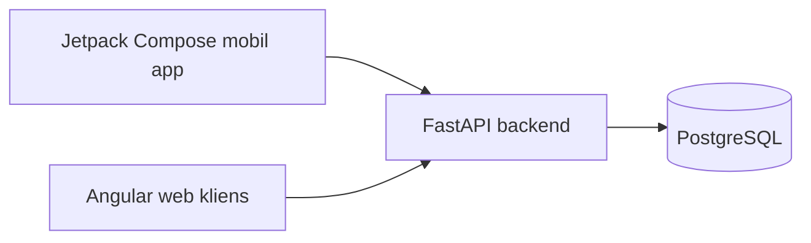

# Kamerás könyvkatalogizáló mobilalkalmazás webes gyűjteménynézettel

## 1. Szereplők és jogosultságok

| Szerep | Igény | Felelősség / hozzáférés |
| --- | --- | --- |
| Felhasználó | Könyvek beolvasása, könyvgyűjtemény megtekintése | Könyveket olvas be és webes felületen kezeli a gyűjteményét |

## 2. Use case-ek / user storyk

### Könyv beolvasása

- **Szereplő:** Felhasználó
- **Előfeltétel:** A szereplő megnyitja a telefonos beolvasó alkalmazást.
- **Fő folyamat:**
  1. A szereplő beolvassa egy könyv ISBN-vonalkódját.
  2. A rendszer lekérdezi az adott ISBN-hez tartozó könyv adatait egy nyilvános adatbázisból.
  3. A rendszer összeveti a lehetséges kiadványokat és megjeleníti a lekérdezett könyv adatait.
  4. A szereplő ellenőrzi és szükség esetén módosítja az adatokat.
  5. A rendszer adatbázisban menti az adatokat.
- **Alternatív / hibafolyamatok:** Ha egy könyv ISBN-vonalkódja nem áll rendelkezése, a rendszer MI-alapú adatkinyeréssel állítja elő az adatokat a könyv borítófotójából, vagy a szereplő adja meg kézileg őket.
- **Utófeltétel:** A szereplő a tárolt könyveket egy webes felületen kezelheti.

### Könyvgyűjtemény kezelése

- **Szereplő:** Felhasználó
- **Előfeltétel:** A szereplő megnyitja a webes gyűjteménynézetet.
- **Fő folyamat:**
  1. A rendszer megjeleníti a gyűjteménybe tartozó könyveket.
  2. A szereplő keresővel vagy szűréssel rákeres egy könyvre.
  3. A rendszer behozza a találatokat.
  4. A szereplő kiválaszt egy könyvet.
  5. A rendszer behozza a könyv részletes adatait.
  6. A szereplő módosítja a könyv adatait vagy akár törli a könyvet.
- **Alternatív / hibafolyamatok:** A szereplő megakarja osztani a gyűjteményét és JSON-formátumban exportálja.
- **Utófeltétel:** A rendszer menti a módosításokat.

## 3. Funkcionális követelmények

| Követelmény | Elfogadási kritérium | Prioritás |
| --- | --- | --- |
| A felhasználó a telefon kamerájával beolvashat egy könyv ISBN-vonalkódját. | Adott olvasható ISBN-vonalkód, amikor a felhasználó a kamerát a vonalkódra irányítja, a rendszer kinyeri és érvényesség szerint ellenőrzi a számot. | Kötelező |
| A rendszer külső forrásból lekéri a kiadvány adatait, és a felhasználó mentés előtt módosíthatja azokat. | Adott érvényes ISBN, amikor a lekérdezés sikeres, a talált adatok szerkeszthető adatlapon jelennek meg; sikertelen lekérdezésnél a felhasználó kézzel folytathatja az adatfelvételt. | Kötelező |
| A felhasználó borítófotóból is azonosíthat könyvet, ha a vonalkód hiányzik vagy olvashatatlan. | Adott borítófotó, amikor a rendszer feldolgozza, címet és szerzőt javasol, a nem látható adatokat pedig üresen hagyja; MI-hiba esetén a kézi felvétel továbbra is működik. | Kötelező |
| A rendszer mezőnként megőrzi az adat eredetét. | Adott mentett könyv, amikor a felhasználó megnyitja az adatlapját, minden mezőnél látható, hogy az érték fotóból, külső forrásból vagy felhasználói javításból származik. | Kötelező |
| A rendszer jelzi a lehetséges ismételt felvételt, a mű, a kiadás és a saját példány pedig külön entitás. | Adott már meglévő kiadás, amikor a felhasználó újra felveszi, a rendszer figyelmeztet, de új saját példányként mégis menthető. | Kötelező |
| A webes felületen a gyűjtemény böngészhető, kereshető és szűrhető. | Adott mentett gyűjtemény, amikor a felhasználó keres cím vagy szerző szerint, vagy szűr szerzőre vagy tárolási helyre, a lista csak a megfelelő könyveket mutatja, és az adatlap megnyitható. | Kötelező |
| A gyűjtemény tartósan tárolódik, és verziójelölt JSON-formátumban exportálható és importálható. | Adott gyűjtemény, amikor az alkalmazások újraindulnak, az adatok megmaradnak; érvénytelen importnál a meglévő gyűjtemény változatlan marad, ismételt importnál nem jön létre duplikátum. | Kötelező |
| A felhasználó javíthatja és törölheti a mentett bejegyzéseket. | Adott mentett bejegyzés, amikor a felhasználó módosítja vagy törli, a változás a webes nézetben is megjelenik. | Kötelező |
| A rendszer természetes nyelvű keresést kínál a saját katalógusban. | Adott szabad szöveges kérdés, amikor a felhasználó elküldi, a rendszer a katalógusból releváns könyveket listáz. | Ajánlott |

Prioritás: **Kötelező** = a végtermékhez szükséges; **Ajánlott** = fontos; **Lehetséges** = idő esetén opcionális.

## 4. Üzleti szabályok és korlátok

| Szabály vagy korlát | Indoklás |
| --- | --- |
| Az ISBN-t kizárólag a vonalkód vagy a külső könyvadatforrás szolgáltathatja, MI-modell nem találhatja ki. | A fotóról kikövetkeztetett ISBN téves kiadáshoz vezethet. |
| Az MI a borítóról csak a látható címet és szerzőt javasolhatja, a kiadót és az évet nem. | A nem látható adat ellenőrizetlen kitöltése megbízhatatlan katalógushoz vezetne. |
| Az MI kimenete csak sémaellenőrzés után kerülhet az adatlapra, és a felhasználó mentés előtt minden mezőt módosíthat. | A hibás vagy téves adat nem kerülhet észrevétlenül a gyűjteménybe. |
| Minden mező megőrzi az eredetét: fotó, külső forrás vagy felhasználói javítás. | Így követhető, melyik adat mennyire megbízható. |
| Lehetséges ismételt felvételnél a rendszer figyelmeztet, de nem tiltja a mentést. | A felhasználó szándékosan is felvehet több példányt vagy eltérő kiadást. |
| Hibás lekérdezés, megszakadt mentés vagy érvénytelen import nem módosíthatja a korábban tárolt gyűjteményt. | Megelőzi az adatvesztést. |

## 5. Felhasználói felület és munkafolyamat

A telefonos alkalmazás főképernyőjén három gomb található: ISBN beolvasása, MI-alapú beolvasás és kézi bevitel. Mindhárom út ugyanarra a szerkeszthető adatlapra vezet, ahol mentés előtt minden mező módosítható, a hiányzó vagy bizonytalan mezők jelölve látszanak, és minden mezőnél látható az adat eredete. Sikertelen beolvasás vagy lekérdezés esetén a felhasználó közvetlenül átválthat a másik két útra. Ismételt felvételnél a rendszer figyelmeztet, de a mentés engedélyezett, és a mentés eredményéről visszajelzést ad. A webes felület listanézetben mutatja a gyűjteményt, kereséssel, szűréssel és részletes adatlappal, a gyűjtemény pedig JSON-fájlba exportálható.

## 6. Nem funkcionális követelmények

| Követelmény | Ellenőrzés módja |
| --- | --- |
| Az ISBN-vonalkód beolvasása jó fényviszonyok mellett 5 másodpercen belül sikerül. | Időmérés valós készüléken, a dokumentált mintakönyvekkel. |
| A külső adatlekérdezés és a borítófotós MI-azonosítás normál körülmények között 10 másodpercen belül eredményt vagy hibajelzést ad. | Késleltetésmérés a mintakönyvekkel és a tesztfotókkal. |
| Egy új felhasználó külső dokumentáció nélkül fel tud venni egy könyvet bármelyik úton (vonalkód, fotó, kézi bevitel). | Megfigyeléses használhatósági teszt egy reprezentatív felhasználóval. |
| Hibás lekérdezés, megszakadt mentés vagy érvénytelen import nem sérti a korábban tárolt gyűjteményt. | Automatizált teszt szimulált hibákkal és ismételt importtal. |
| A webes felület telefonon és asztali képernyőn is használható modern böngészőben. | Kézi teszt különböző képernyőméreteken. |

## 7. Nyitott kérdések és kockázatok
 
| Kérdés / kockázat | Hatás | Felelős | Feloldás / döntés |
| --- | --- | --- | --- |
| A külső könyvadatforrások gyengén fedhetik le a magyar kiadványokat. | Több kézi javítás és sikertelen azonosítás. | Hallgató | Google Books és Open Library együttes használata, a lefedettség mérése a mintakönyveken, a kézi felvétel mindig elérhető. |
| A borítófotós MI tévesen azonosíthat címet vagy szerzőt. | Hibás adat kerülhet a katalógusba. | Hallgató | Sémaellenőrzés, kötelező felhasználói ellenőrzés mentés előtt. |
| Az MI-hívások késleltetése és költsége nem ismert pontosan. | Lassú vagy drága felvétel. | Hallgató | Mérés a tesztfotókon, a modell kiválasztása a mért pontosság, költség és késleltetés alapján. |
| A feltöltött borítófotók megőrzése és a külső MI-szolgáltatás adatkezelése még nincs eldöntve. | Adatvédelmi kockázat. | Hallgató | A fotó csak a feldolgozás idejére tárolódik, a megőrzési szabály dokumentálása. |

## 8. Kezdeti technikai javaslat

### Javasolt megoldás

A javasolt rendszer backendje a python alapú FastAPI keretrendszer, amely JSON-alapon kommunikál a Jetpack Compose mobilalkalmazással és az Angular frontenddel, az adatokat pedig egy PostgreSQL adatbázisba menti. A Jetpack Compose mobilakalmazás felel a könyvek kamerás beolvasásáért. A backend kezeli az adategyeztetést és kommunikál a külső könyvadatforrással és LLM-el. A frontend felel a gyűjtemény megjelenítéséért és szerkesztéséért.

### Technológiai irány

| Terület | Jelölt technológia / megközelítés | Megfontolás oka | Nyitott kérdés / kockázat |
| --- | --- | --- | --- |
| Mobilalkalmazás | Jetpack Compose (Kotlin) | Natív Android UI, zökkenőmentes CameraX + ML Kit integráció a vonalkód-beolvasáshoz | iOS-támogatás nincs tervezve, csak Android |
| Web kliens | Angular (TypeScript) | Beépített routing, HTTP-kliens és reaktív állapotkezelés | SPA build-lánc és Angular tanulási görbe plusz ráfordítást jelent |
| Backend | FastAPI (Python) | Async Python, automatikus OpenAPI-séma, Pydantic-alapú validáció az AI-kimenethez | A JSON API-szerződést mindkét kliens felé egységesen kell tartani |
| Adatbázis-elérés | SQLAlchemy | Típusos ORM-leképezés mű/kiadás/példány entitásokhoz | Az entitásmodell véglegesítése előtt pontosítani kell a kapcsolatokat |
| Adattárolás | PostgreSQL | Relációs tárolás a mű–kiadás–példány modellhez | Helyi fejlesztéshez Docker Compose-ban futtatva |
| Borítófelismerés | Vision LLM | Egy hívásban kezeli a stilizált borítószöveget, nem igényel külön OCR-lépést | Validálni kell OCR-alapú baseline-nal szemben |

### Kezdeti architektúravázlat

### Megvalósíthatóság és technikai kockázatok

| Kockázat / feltételezés | A 2. félévre tervezett validáció | Tartalék megközelítés |
| --- | --- | --- |
| A megszakadt mentés és az ismételt import nem sérti a gyűjteményt. | Automatizált teszt szimulált megszakítással és ismételt importtal. | Import előtti ellenőrző lépés. |