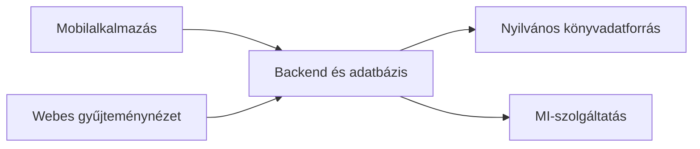

<!-- @gap 10 -->
<!-- 5xl -->
# Kamerás könyvkatalogizáló mobilalkalmazás webes gyűjteménynézettel
<!-- @gap 5 -->
Szerző: Horváth Máté  
Neptun: V3ZQEC  
Témavezető: Sári Dávid  
Projektazonosító: 2026-SD-01  

---

## Probléma
<!-- @gap 3 -->
- Otthoni könyvgyűjtemény kézi nyilvántartása időigényes
- A gyűjtemény nehezen áttekinthető és kereshető
- Ismételt felvétel nehezen vehető észre
- Cél: gyors, ellenőrizhető felvétel a telefon kamerájával

---

## Célfelhasználók
<!-- @gap 3 -->
- Nagy könyvgyűjteménnyel rendelkezők
- Otthoni felhasználás
- Egy felhasználó, egy gyűjtemény
- Gyors nyilvántartás és visszakereshetőség

---

## Tervezett hatókör
<!-- @gap 3 -->
- Könyvek beolvasása Android-alkalmazással
- Adatok lekérdezése nyilvános adatbázisból
- MI-alapú adatkinyerés a borítófotóból
- Tárolás saját adatbázisban
- Kereshető, szűrhető, szerkeszthető webes gyűjteménynézet
<!-- @gap 3 -->
<!-- @scale 60% -->

---

## Kezdeti felhasználói utak
<!-- @gap 3 -->
- **Beolvasás ISBN-vonalkóddal**
  - Beolvasás, lekérdezés, ellenőrzés, mentés
- **Ha nincs vonalkód**
  - MI-alapú beolvasás vagy kézi bevitel
- **Gyűjtemény kezelése weben**
  - Keresés, szűrés, részletek, módosítás, törlés
- **Megosztás**
  - A gyűjtemény exportálása JSON-fájlba

---

## Következő lépések
<!-- @gap 3 -->
- Könyvadatforrások vizsgálata
- Adatmodell véglegesítése
- Vonalkód-beolvasás prototípusa valós készüléken
- Borítófotós MI és OCR összehasonlítása

---

<!-- @gap 20 -->
<!-- 5xl -->
# Köszönöm a figyelmet!
